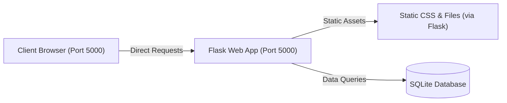
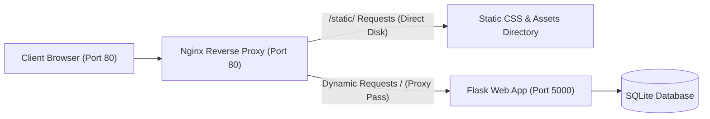

# Implementation Plan: Reverse Proxying ShopLite Flask App with Nginx on Windows

Configure **Nginx** (`C:\nginx\nginx-1.30.4`) to act as a front-end reverse proxy for the **ShopLite E-Commerce** Flask app running on port 5000 (`http://127.0.0.1:5000`).

---

## Architecture Comparison: Before vs. After

### 1. Architecture BEFORE (Direct Connection)
Clients connect directly to the Flask built-in development web server on port 5000. Flask handles web requests, dynamic routing, database queries, and serving static CSS/image files.



### 2. Architecture AFTER (With Nginx Reverse Proxy)
Clients connect to **Nginx** on standard HTTP **Port 80**. Nginx directly serves static assets (images, CSS) from disk for maximum speed, and proxies all application requests to the Flask server running locally on **Port 5000**.



---

## User Review Required

> [!IMPORTANT]
> - Nginx will bind to **port 80** by default. Ensure no other web server (such as IIS, Apache, or another service) is currently using port 80 on your system.
> - The Flask app will continue running on **port 5000** in the background, while users connect through Nginx on port 80.

---

## Proposed Changes

### Configuration Comparison

#### Original Nginx Server Block (BEFORE)
In default `C:\nginx\nginx-1.30.4\conf\nginx.conf`:
```nginx
server {
    listen       80;
    server_name  localhost;

    location / {
        root   html;
        index  index.html index.htm;
    }

    error_page   500 502 503 504  /50x.html;
    location = /50x.html {
        root   html;
    }
}
```

#### Updated Nginx Server Block (AFTER)
#### [MODIFY] [nginx.conf](file:///C:/nginx/nginx-1.30.4/conf/nginx.conf)

Replace the default `server` block in `C:\nginx\nginx-1.30.4\conf\nginx.conf` with:

```nginx
server {
    listen       80;
    server_name  localhost;

    # Forward all standard requests to Flask app on port 5000
    location / {
        proxy_pass         http://127.0.0.1:5000;
        proxy_set_header   Host $host;
        proxy_set_header   X-Real-IP $remote_addr;
        proxy_set_header   X-Forwarded-For $proxy_add_x_forwarded_for;
        proxy_set_header   X-Forwarded-Proto $scheme;
    }

    # Serve static assets directly via Nginx for high efficiency
    location /static/ {
        alias "C:/Users/Administrator/source/repos/Honda/Other Projects/Nginx demo/shoplite-ecommerce/ecommerce/static/";
        expires 30d;
        add_header Cache-Control "public, no-transform";
    }

    error_page   500 502 503 504  /50x.html;
    location = /50x.html {
        root   html;
    }
}
```

---

## Execution Steps

1. **Verify Flask is Running**:
   Ensure `app.py` is running on port 5000 in `c:\Users\Administrator\source\repos\Honda\Other Projects\Nginx demo\shoplite-ecommerce\ecommerce`.

2. **Update Nginx Configuration**:
   Apply the updated server block to `C:\nginx\nginx-1.30.4\conf\nginx.conf`.

3. **Validate & Start Nginx**:
   In PowerShell at `C:\nginx\nginx-1.30.4`:
   ```powershell
   .\nginx.exe -t          # Test config syntax
   start nginx             # Start Nginx in background
   ```

4. **Useful Nginx Management Commands**:
   - Reload configuration: `.\nginx.exe -s reload`
   - Stop Nginx cleanly: `.\nginx.exe -s stop`
   - Fast shutdown: `.\nginx.exe -s quit`

---

## Verification Plan

### Automated / Terminal Verification
- Run `Invoke-WebRequest -Uri "http://localhost"` in PowerShell to verify Nginx returns status `200 OK` with the ShopLite homepage HTML.
- Run `Invoke-WebRequest -Uri "http://localhost/static/css/style.css"` to confirm static files are served directly by Nginx.

### Manual Verification
- Open `http://localhost` in the web browser.
- Test browsing products, adding items to cart, and user login through Nginx port 80.
