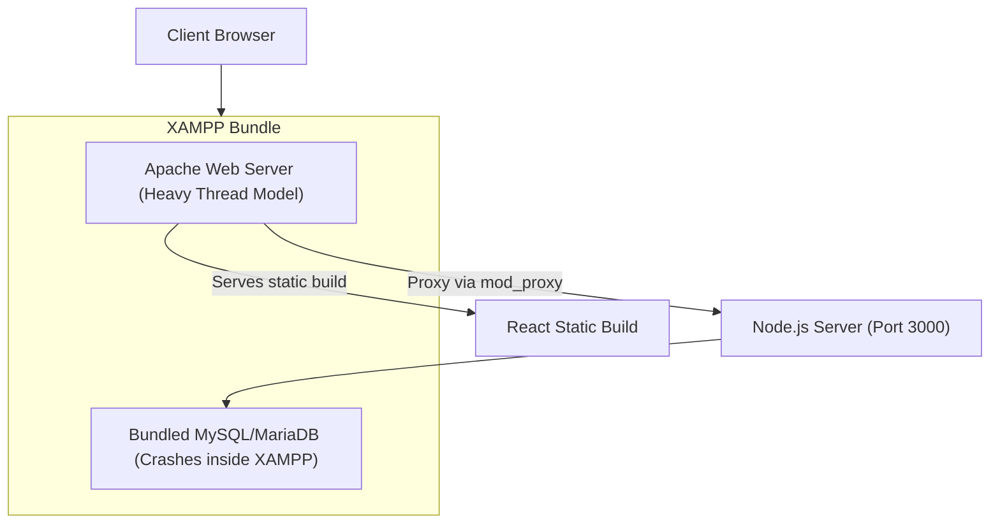
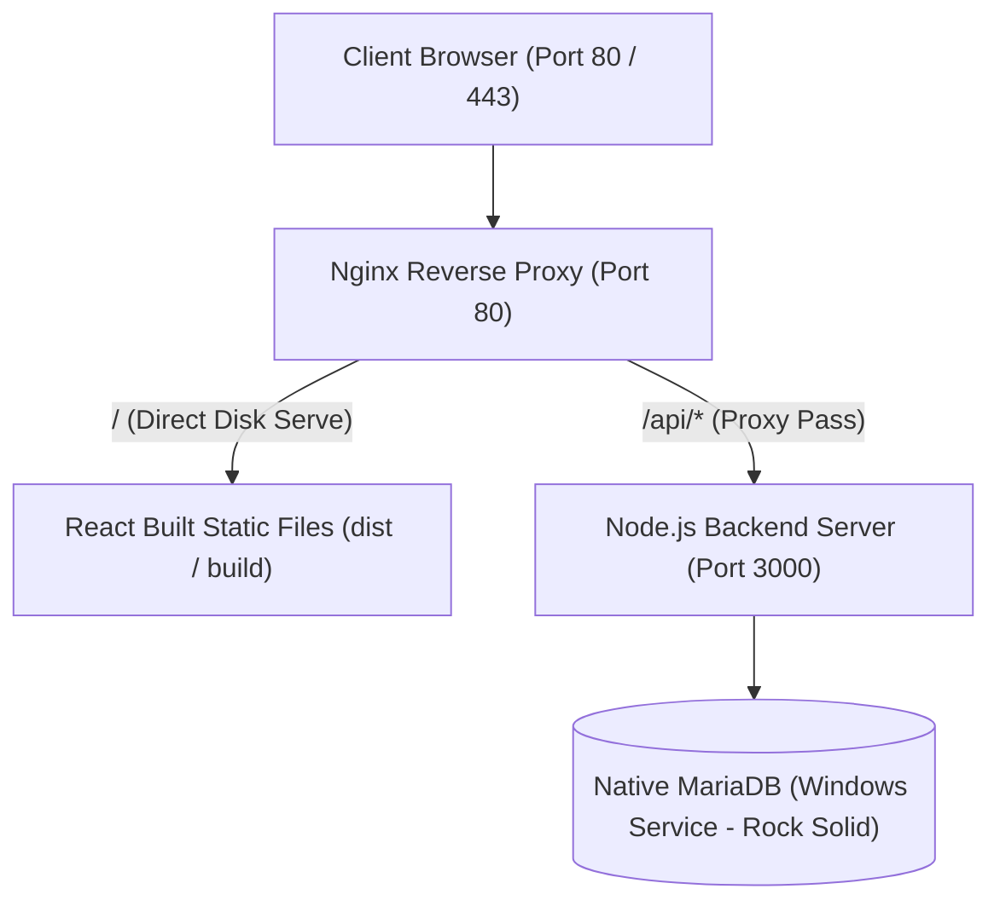

# Comprehensive Migration Guide: Replacing XAMPP Apache with Nginx for React & Node.js

This document provides a technical overview and step-by-step guide for migrating your application stack from **XAMPP (Apache)** to a high-performance, crash-resilient production stack powered by **Nginx**, **Native MariaDB**, **Node.js**, and **React**.

---

## 1. Executive Summary & Problem Analysis

### The Problem with XAMPP / Apache for Node + React
XAMPP was created for PHP/MySQL development (**LAMP/WAMP stack**). When used as a front-end server or proxy for Node.js and React:
* **Process-Per-Request Model**: Apache allocates heavy OS threads per connection (`mod_proxy`), which quickly exhausts system RAM during concurrent API requests or WebSocket connections.
* **Fragile Monolith**: XAMPP bundles MySQL/MariaDB, Apache, and Tomcat inside a desktop control panel. When Apache crashes or freezes, it takes down database access and proxy connections.
* **SPA Routing Issues**: Apache requires complex `.htaccess` rewrite rules to handle React Router client-side routes correctly.

### The Nginx Solution
* **Event-Driven Architecture**: Nginx handles tens of thousands of concurrent connections using an asynchronous event loop, using only **~15 MB of RAM**.
* **Direct Static Serving**: Nginx serves React compiled static builds (`dist` / `build`) directly from disk with zero Node.js or Apache overhead.
* **Decoupled Native MariaDB**: Running MariaDB as an independent Windows Service ensures database uptime is completely isolated from web server restarts.

---

## 2. Architecture Comparison

### Old Architecture (XAMPP / Apache) ❌



---

### New Architecture (Nginx + Native MariaDB) ✅



---

## 3. Production Stack Overview

| Component | Role | Hosted / Managed By | Port |
| :--- | :--- | :--- | :--- |
| **Nginx** | Front-end Web Server & API Proxy | Windows Service / Executable | `80` (HTTP) / `443` (HTTPS) |
| **React SPA** | Frontend User Interface | Served directly by Nginx from disk | N/A (Static files) |
| **Node.js** | Backend API & Business Logic | Node.js / PM2 / Windows Service | `3000` (Internal loopback) |
| **MariaDB** | Relational Database | Native Windows Service (`MariaDB`) | `3306` |

---

## 4. Step-by-Step Migration Guide

### Step 1: Native MariaDB Verification
Ensure Native MariaDB is running as an automatic Windows Service:
```powershell
# Check service status in PowerShell
Get-Service -Name "MariaDB*"
```
Update your Node.js `.env` database connection configuration to connect to `127.0.0.1:3306` with your native MariaDB credentials.

---

### Step 2: Build the React Application
In your React project folder, generate the optimized production build:
```powershell
npm run build
```
This creates a `dist/` (Vite) or `build/` (Create React App) directory containing static `index.html`, JavaScript bundles, and CSS.

---

### Step 3: Configure Nginx (`nginx.conf`)
Open `C:\nginx\nginx-1.30.4\conf\nginx.conf` and update the `server` block:

```nginx
worker_processes  auto;

events {
    worker_connections  1024;
}

http {
    include       mime.types;
    default_type  application/octet-stream;
    
    # Enable Gzip Compression for fast React loading
    gzip on;
    gzip_types text/plain text/css application/json application/javascript text/xml application/xml;

    sendfile        on;
    keepalive_timeout  65;

    server {
        listen       80;
        server_name  localhost; # Or your server domain / IP

        # ----------------------------------------------------
        # 1. REACT FRONTEND (Direct Disk Serving)
        # ----------------------------------------------------
        location / {
            root   "C:/path/to/your/react-app/dist"; # Update to your build path
            index  index.html index.htm;
            
            # Crucial for React Router SPA (prevents 404 on page refresh)
            try_files $uri $uri/ /index.html;
        }

        # Cache static assets (JS, CSS, Images)
        location /assets/ {
            root "C:/path/to/your/react-app/dist";
            expires 1y;
            add_header Cache-Control "public, no-transform";
        }

        # ----------------------------------------------------
        # 2. NODE.JS BACKEND API PROXY
        # ----------------------------------------------------
        location /api/ {
            proxy_pass         http://127.0.0.1:3000/; # Node.js backend port
            proxy_http_version 1.1;
            
            # Preserve headers and client IP
            proxy_set_header   Host $host;
            proxy_set_header   X-Real-IP $remote_addr;
            proxy_set_header   X-Forwarded-For $proxy_add_x_forwarded_for;
            proxy_set_header   X-Forwarded-Proto $scheme;

            # Enable WebSockets support (Socket.io / WS) if needed
            proxy_set_header   Upgrade $http_upgrade;
            proxy_set_header   Connection "upgrade";
        }

        # Standard error pages
        error_page   500 502 503 504  /50x.html;
        location = /50x.html {
            root   html;
        }
    }
}
```

---

### Step 4: Test & Launch Nginx

1. **Test Nginx Syntax**:
   ```powershell
   cd C:\nginx\nginx-1.30.4
   .\nginx.exe -t
   ```
2. **Start Nginx**:
   ```powershell
   start nginx
   ```
3. **Reload Nginx (after config changes)**:
   ```powershell
   .\nginx.exe -s reload
   ```

---

## 5. Summary of Key Advantages

| Feature | XAMPP / Apache | Nginx + Native Stack |
| :--- | :--- | :--- |
| **Stability** | High crash frequency under load | **Rock solid (99.99% uptime)** |
| **RAM Usage** | ~200MB - 500MB+ | **~15MB - 30MB** |
| **React Router Support** | Needs complex `.htaccess` rules | Supported natively via `try_files` |
| **Static File Speed** | Moderate | **Blazing fast (kernel `sendfile`)** |
| **Database Isolation** | Bundled (Restarts take DB down) | **Isolated Native Windows Service** |
